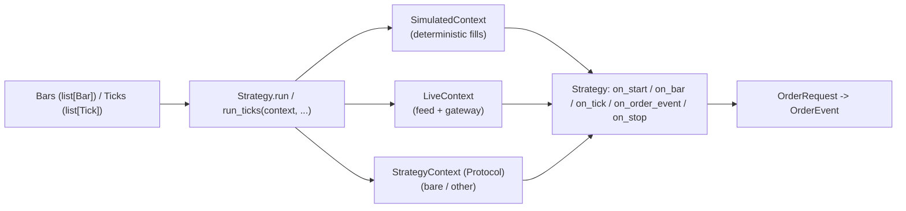

# `tantra-strategies` — Architecture & Bounded Context

**Bounded Context**: Production Strategy SDK & Declarative Step Catalog (Tier 6C).

`tantra-strategies` is the canonical quantitative strategy repository of the
Tantra ecosystem. It provides a pure-Python, Jesse-style strategy authoring SDK
(`on_start` / `on_bar` / `on_tick` / `on_order_event` / `on_stop`), a ported
catalog of StockSharp-inspired strategies, and a declarative manifest layer
(step catalogs + versioned strategy/basket manifests) that names strategies by
`module:Class` for downstream tooling.

## 1. 4-Zone Clean Package

```
tantra-strategies/
├── tantra_strategies/   # Zone 1: pure-Python SDK + strategies + manifest models
├── catalog_steps/        # Zone 2: runnable pipeline steps (+ registry.json)
├── manifests/            # Zone 2: versioned strategy & basket sidecars (plan 0001)
│   ├── strategies/       #   StrategyManifest TOML sidecars
│   └── baskets/          #   BasketManifest TOML groupings
├── tests/                # Zone 3: unit / lifecycle / manifest-validation tests
├── schema/               # Zone 4: JSON schemas (step, strategy-manifest, basket-manifest)
├── tools/                # Zone 4: manifest linters
└── docs/                 # Zone 4: architecture, code references, gaps, plans
```

### Zone 1 — `tantra_strategies/`

Pure Python 3.11+, zero network/filesystem I/O in strategy logic. All financial
math uses `decimal.Decimal` (zero-floats policy).

| Subpackage | Contents |
| :--- | :--- |
| `sdk/` | `Strategy` base class + `IndicatorRegistry`, streaming indicators (`SMA`, `EMA`, `RSI`, `ATR`, `BollingerBands`), `Parameter` descriptor, `Bar`, order domain (`OrderRequest`/`OrderEvent`/`OrderSide`/`OrderType`/`OrderStatus`/`TimeInForce`), `StrategyContext` protocol + `SimulatedContext` harness, `QuoteState` mixin. |
| `strategies/` | Ten ported strategy classes (see `code-strategies.md`). |
| `manifest/` | Pydantic models: `StrategyManifest`, `BasketManifest`, `ParameterSpec`, `InstrumentSelector`, `CapitalAllocation`, `MemberStrategyRef`, `RiskBudget`, `PromotionStatus`/`PromotionRecord` and the `promote()` workflow (plan 0001). |
| `_compat.py` | Optional interop with the `tantra` native wheel; `VYAAPAAR_AVAILABLE` flag, `decimal.Decimal` fallback. |

### Zone 2 — `catalog_steps/` & `manifests/`

- `catalog_steps/` + `registry.json` — runnable pipeline steps.
- `manifests/strategies/*.toml` — versioned, promotable `StrategyManifest`
  sidecars (11 files; the former `catalog/` step manifests were migrated here
  on 2026-11-20). Each names `name`, optional `title`/`family` (one of eight
  families), `version`, `strategy = module:Class`, `[parameters.*]` snapshots
  (`min`/`max`/`step`), target instruments, and a capital allocation.
- `manifests/baskets/*.toml` — `BasketManifest` groupings
  (`turtle_twap_basket`) under a combined capital and Phase-1 risk budget.

### Zone 3 — `tests/`

Tests live in `tests/` parallel to the package (never inlined into
`tantra_strategies/`). Suites: `tests/sdk/` (indicators, parameters, strategy
lifecycle), `tests/strategies/` (one file per strategy), `tests/manifests/`
(manifest models, promotion, schema conformance), `tests/test_init.py` (package export).

### Zone 4 — `schema/` & `tools/`

- `schema/strategy-manifest.schema.json`,
  `schema/basket-manifest.schema.json` — JSON Schema (draft-07) mirrors of the
  catalog and manifest TOML shapes.
- `tools/validate_manifests.py` — schema + pydantic model + parameter
  cross-check + instantiate for strategy manifests; schema + model + member-ref
  resolution for basket manifests.

## 2. Event Loop & Research–Live Parity Goal

Strategies never talk to a broker or feed directly; they run inside an
execution `StrategyContext` injected via `Strategy.run(context, bars)` /
`Strategy.run_ticks(context, ticks)`.



- Two concrete contexts ship in-repo. `SimulatedContext` is the deterministic
  offline harness: market orders fill immediately at the current price, resting
  limit orders fill at their limit price once crossed and are re-checked per
  bar/tick. `LiveContext` (gap 0002) is the research-live parity seam backed by
  a `MarketDataFeed` + `ExecutionGateway`, serving prices from the feed and
  routing orders through the gateway; the canonical Rust traits are owned by
  `tantra-market` / `tantra-exec`.
- The `StrategyContext` protocol (`submit`, `current_price`, `position`) is the
  parity contract: any context with `run`/`run_ticks` drives itself, and a bare
  protocol implementation is driven by the strategy's generic branch.
- `on_tick` is fully dispatched (bar and tick paths both supported), so
  tick-level market-making/quoting strategies run on the same SDK — closed
  gaps 0001/0002.

## 3. Declarative Layers & Cross-Repo Consumption

- The `manifests/strategies/` manifests are **proven runnable in-repo**:
  `tools/validate_manifests.py` + `tests/manifests/` prove schema conformance
  and that every `module:Class` reference imports and instantiates, and
  `tools/run_step.py` + `tests/manifests/test_manifest_executor.py` run every manifest
  through `SimulatedContext` against a deterministic bar series (gap 0003
  closed). Executing a step against a live broker/feed remains owned by
  `tantra-runtime` / `tantra-exec`; visual-studio chaining is owned by
  `tantra-ui`.
- `BasketManifest` consumption is now implemented in-repo as the reference
  run loop: `optimize_allocations` sizes member capital under the `RiskBudget`
  caps and `basket_run.run_basket` executes each member through
  `SimulatedContext` and enforces the budget (`RiskBudgetViolation`) — gaps
  0004/0005 closed. The production path in `tantra-runtime-backtest`
  (catalog.rs/engine.rs) remains a cross-repo consumer.

## 4. Zero-Floats / Decimal Policy

- Prices, quantities, basis, allocations, weights, and indicator outputs are
  `decimal.Decimal` throughout. Integer parameters are converted exactly
  (`Decimal(str(value))`); no `float` appears in financial paths.
- `BollingerBands._stddev`, `RiskParity._volatility` use `Decimal.sqrt`
  (rounded at the active decimal context precision, as the tests note).
- `Parameter` values are validated against `min`/`max` and aligned to `step`
  from `min` using exact `Decimal` modular arithmetic.
